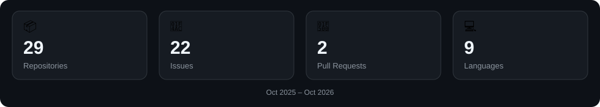

# Sourav Yadav

### Software Engineer · Backend & Full-Stack Developer · Web3 Protocol Engineer · Smart Contract Security Researcher

Building reliable software across backend systems, full-stack applications, Web3 protocols, and smart contract security.

 

 

[GitHub](https://github.com/Sourav-IIITBPL) ·
[LinkedIn](https://linkedin.com/in/0xsourav) ·
[X](https://x.com/0xSouravAudit) ·
[Email](mailto:sourav.dev.official@outlook.com)

 

---

## Snapshot

  

---

## About

I am a software engineer focused on building and securing complex, high-reliability software across **backend systems, full-stack web applications, Web3 protocols, and smart contract security**.

- **Software & Systems Engineering:** Building modular REST services, database pipelines (PostgreSQL/Redis), and decoupled React/TypeScript frontends with rigorous testing, validation, and practical AI tooling.
- **Web3 Protocols & Security:** Developing EVM smart contracts (Solidity/Foundry), multi-chain DEX routing infrastructure, and conducting invariant testing, fuzzing, and competitive audit reviews.

**Currently open to:** Software Development Engineer (SDE) · Backend & Full-Stack Engineering · Web3 Protocol Engineering · Smart Contract Security

---

## Engineering Focus

### 🧱 Software Engineering & Systems
DSA · OOP · DBMS · Operating Systems · Computer Networks · System Design · REST APIs · Full-Stack Development

### ⚙️ Backend & Architecture
Node.js · Express.js · PostgreSQL · MySQL · Redis · Prisma ORM · API Validation (Zod) · Modular Architecture · Workflow Orchestration

### ⛓️ Web3 & Protocol Engineering
Solidity · EVM · DeFi · DEX Routing · Uniswap V2 · ERC-4626 Vaults · Protocol Architecture · Foundry · Viem

### 🛡️ Smart Contract Security
Manual Code Review · Invariant Analysis · Fuzz Testing · Exploit PoCs · Adversarial Testing · Protocol Accounting

### 🤖 AI-Native Engineering
LLM API Integration · Agentic Workflows · AI-Assisted Development · Developer Automation · Prompt Engineering

---

## Featured Projects

### PreFlight

**Zero-Trust DeFi Transaction Security Platform**

- Architected a hybrid risk engine with 4 modular Solidity guards (covering AMMs and ERC-4626 vaults) deployed on Arbitrum, Ethereum, and Base Sepolia testnets.
- Integrated Chainlink CRE off-chain simulation on forked state and trace analysis to detect suspicious calls, `DELEGATECALL` activity, and unexpected ERC-20 transfers before execution.

[Repository →](https://github.com/Sourav-IIITBPL/preflight) · [Live Demo →](https://preflight-v1.vercel.app/)

### Protocol Invariant Checker

**Modular DeFi Security Analysis Framework & Rust CLI**

- Developed a modular Rust CLI for protocol invariant testing and audit reporting using a protocol-agnostic `Protocol` trait architecture.
- Integrated an ERC-4626 vault module with 6 documented invariants, state simulation, and severity-rated findings; 11 passing tests.

[Repository →](https://github.com/Sourav-IIITBPL/protocol-invariant-checker)

### DexGateway

**Multi-Chain DEX Routing Infrastructure**

- Engineered full-stack DEX routing infrastructure across 7 Uniswap V2-style DEXes using reusable router abstractions for swaps and liquidity management.
- Implemented liquidity discovery algorithms, multi-chain transaction workflows, and seamless frontend state tracking.

[Repository →](https://github.com/Sourav-IIITBPL/DexGateway)

### FLUX

**Intelligent Creative Layout Engine**

- Built a deterministic constraint-satisfaction layout engine with priority sizing, repositioning, and AABB collision resolution across 8 tested viewports.
- Fully decoupled pure-function layout math from React rendering (zero DOM measurement overhead); managed state with Zustand and Framer Motion.

[Repository →](https://github.com/Sourav-IIITBPL/FLUX-Intelligent-Creative-Layout-Engine) · [Live Demo →](https://flux-intelligent-creative-layout-en.vercel.app/)

### AI Trip Planner

**Full-Stack AI-Powered Itinerary Generator**

- Built a full-stack web application converting natural language travel requests into structured day-by-day itineraries via Google Gemini.
- Architected a secure Node.js/Express backend keeping API keys server-side with strict Zod schema validation and defensive error handling.

[Repository →](https://github.com/Sourav-IIITBPL/ai-trip-planner) · [Live Demo →](https://ai-trip-planner-v1.vercel.app/)

---

## Smart Contract Security Track Record

Independent security researcher participating across **Sherlock, Code4rena, and Cantina** since July 2025.

- **20+ smart contract codebases audited** across competitive audits and security contests
- **11 validated findings:** 2 High, 3 Medium, and 6 Low severity vulnerabilities
- Reviewed AMMs, lending protocols, ERC-4626 vaults, staking mechanisms, and DEX infrastructure
- Focused on protocol accounting, invariant analysis, state transitions, and economic attack vectors
- Applied systematic methodology: manual code review → invariant reasoning → adversarial edge-case testing → reproducible Foundry PoC → root-cause reporting

[Audit Archive →](https://github.com/Sourav-IIITBPL/audits)

---

## Competitive Programming

- 🏆 **[LeetCode Knight](https://leetcode.com/u/SouravIIIT)** — 1892 max rating · 500+ problems solved
- ⭐ **[CodeChef 2★](https://www.codechef.com/users/sourav_yadav25)** — 1543 max rating
- Strong foundations in data structures, algorithms, complexity analysis, and mathematical problem solving

---

## Tech Stack

### Languages

### Backend & Data

### Smart Contracts & Security

### Web3 & Blockchain

### Frontend

### AI / ML & Agentic Engineering

### Platforms & Tools

---

## GitHub Activity

  

---

## 🏆 Achievements & Certifications

- **LeetCode Knight** — 1892 max rating · 500+ DSA problems solved
- **CodeChef 2-Star Coder** — 1543 max rating
- **HackVision 2026** — Top 100 finalist among 400+ teams
- **Smart India Hackathon 2024** — National-level Participant & Team Lead
- **Cyfrin Updraft** — Smart Contract Development & Security Certification
- **AlgoUniversity Tech Fellowship** — 2024 Stage 1 qualifier (Top 4,000 among 20,000 participants)
- **HER DAO Rust Cohort 1** — Graduate

---

## Education

**Indian Institute of Information Technology, Bhopal**  
*B.Tech in Electronics & Communication Engineering* · CGPA: 7.57/10  
Expected Graduation: 2027

---

### Open to Software Development · Backend & Full-Stack · Web3 Protocol Engineering · Smart Contract Security Roles

**sourav.dev.official@outlook.com**

